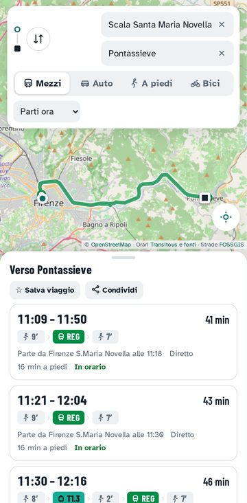
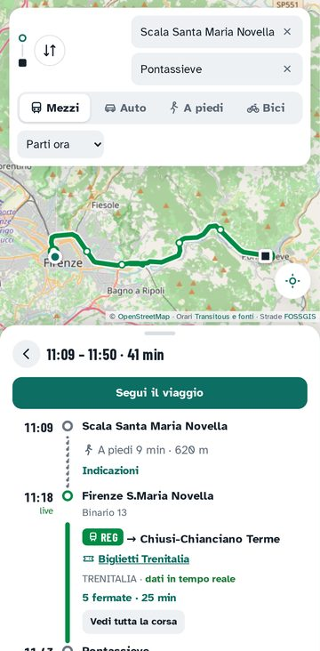
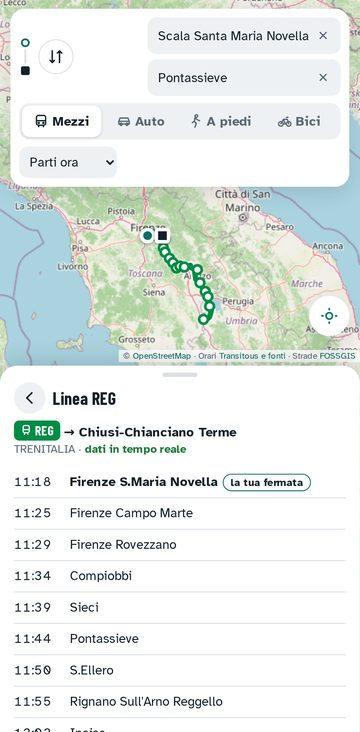
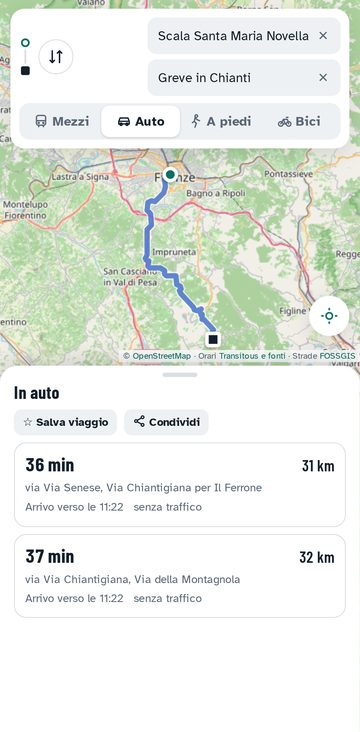
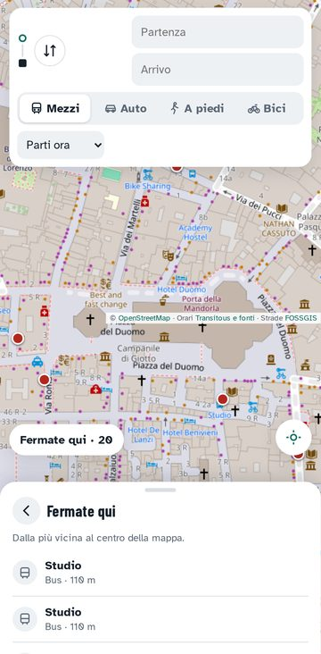
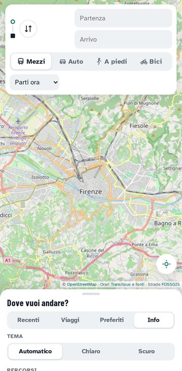

# Girovia

Mezzi pubblici, auto, bici e piedi per Firenze e la Toscana, in un'unica app. Senza pubblicità, senza account, senza tracciamento.

**Web:** https://rex11107.github.io/girovia/ · **Android:** [scarica l'APK](https://github.com/Rex11107/girovia/releases/latest/download/girovia.apk) · [Novità](CHANGELOG.md) · [Privacy](privacy.html)

<p>






</p>

<sub>Screenshot con dati reali, presi dai controlli automatici.</sub>

## Cosa fa

**Percorsi**
- **Mezzi pubblici**: bus Autolinee Toscane, treni Trenitalia e TFT, tramvia, con cambi e tratti a piedi. Orari ufficiali (open data GTFS).
- **Auto, bici e a piedi**, con indicazioni svolta per svolta.
- **Bici e monopattini in sharing** nei percorsi e sulla mappa, dove il servizio pubblica i dati (si attiva da solo).
- **Biglietti**: link per acquistare dal dettaglio del viaggio.
- **Condividi** un percorso con un link che riapre lo stesso viaggio.

**Navigazione**
- **Auto, bici e piedi**: prossima indicazione in grande, voce in italiano (disattivabile), ricalcolo se esci dal percorso, schermo sempre acceso.
- **Segui il viaggio con i mezzi**: guida a piedi alla fermata, fermate che mancano, avvisi a voce e con vibrazione quando scendere. Nell'APK anche una notifica 2 minuti prima dell'arrivo, che segue i ritardi.

**Fermate e linee**
- **Partenze** divise per giorno, binario, ritardi quando ci sono, aggiornate da sole ogni 30 secondi.
- **Corsa intera** con tutte le fermate, quelle già passate segnate, e il tragitto sulla mappa.
- **Fermate sulla mappa** (tocco, tastiera o elenco "Fermate qui").
- **Avvisi di servizio** (scioperi, deviazioni, lavori) quando l'azienda li pubblica.

**Comodità**
- **Recenti, Viaggi salvati, Preferiti** con Casa e Lavoro; **scorciatoie** "Vai a Casa" e "Vai al Lavoro" tenendo premuta l'icona.
- **Tema** chiaro, scuro o automatico.
- **Funziona offline** (versione web): si apre senza rete e mostra le zone di mappa già viste.

## Da dove arrivano i dati

| Cosa | Fonte |
|---|---|
| Orari, linee, avvisi, sharing | [Transitous](https://transitous.org) (dati GTFS e GBFS pubblicati da Regione Toscana, Trenitalia e altri) |
| Mappa | [OpenStreetMap](https://www.openstreetmap.org), con riserva automatica su OSM France e CARTO |
| Percorsi in auto, bici e a piedi | [OSRM di FOSSGIS](https://routing.openstreetmap.de) |

L'app non ha un server suo: il telefono chiede i dati direttamente a questi servizi gratuiti. Leaflet e i caratteri sono inclusi nell'app, quindi nessuna richiesta a CDN o a Google Fonts. Dettagli in [privacy.html](privacy.html), anche nell'app nella scheda Info.

## Limiti da sapere

- I **treni Trenitalia** hanno dati in tempo reale (ritardi, binario); i **bus Autolinee Toscane** no: per loro vedi gli orari programmati. Ritardi e avvisi dei bus compariranno da soli quando AT li pubblicherà.
- A Firenze oggi non ci sono dati di **sharing** pubblici in Transitous.
- I tempi **in auto non considerano il traffico**.
- La navigazione funziona con l'app aperta; gli avvisi di discesa a schermo spento si basano sull'orario previsto.
- Transitous è gestito da volontari: uso personale, non commerciale.

## Metterla sul telefono

- **Android**: scarica l'[APK](https://github.com/Rex11107/girovia/releases/latest/download/girovia.apk), aprilo e consenti l'installazione da questa fonte. Gli aggiornamenti si installano sopra la versione precedente.
- **Qualsiasi telefono**: apri https://rex11107.github.io/girovia/ e scegli **Aggiungi a schermata Home**.

## Controlli automatici

A ogni modifica e a ogni pull request, GitHub Actions esegue:

| Controllo | Cosa verifica |
|---|---|
| ESLint, html-validate | errori nel codice, simboli inutilizzati, HTML valido e accessibile |
| Test unitari (`node --test`) | funzioni pure: nomi, orari, geometria, indicazioni, avvisi, biglietti, link condivisi |
| Playwright, dati di esempio | tutta l'interfaccia su un telefono simulato: ricerca, risultati, navigazione con GPS simulato, partenze, sharing, condivisione, tema, Content-Security-Policy |
| Offline | apertura senza rete, avvisi di rete, servizio che non risponde, mappa di riserva |
| Accessibilità (axe) | WCAG 2.1 A e AA su tutte le schermate, nei temi chiaro e scuro |
| Dati reali | chiamate vere a Transitous e OSRM su tratte di Firenze e provincia, e l'app usata come da una persona, con screenshot. Gira anche ogni giorno feriale |
| APK | compilazione, firma e confronto dell'impronta con quella attesa |

I risultati con i dati reali (rapporto e screenshot) finiscono nel ramo `risultati-test`.

## Sviluppo

```bash
npm ci
npm run serve        # http://127.0.0.1:4173
npm run lint
npm test             # unitari, interfaccia, offline, accessibilità
npm run test:live    # con i servizi reali
```

Struttura del codice, regole e rilasci: [CONTRIBUTING.md](CONTRIBUTING.md).

Licenza MIT. Leaflet (BSD-2-Clause) e i caratteri Atkinson Hyperlegible e Barlow Condensed (SIL OFL 1.1) hanno le loro licenze in `vendor/` e `fonts/`.
